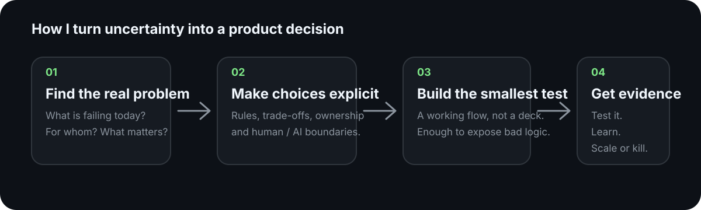

# Daria Karpova

### Product Systems · AI · 0→1 · Fractional Product Lead

I turn unclear product problems into working systems people can actually use — then test whether the logic survives reality.

Barcelona · Remote Europe

7+ years across EdTech, consumer apps, fintech and early-stage product work.

---

## What I do

Most of my work starts before there is a neat product brief.

A team has a messy process, an AI idea, conflicting requirements, too many manual decisions, or a promising concept that is still mostly assumptions. I work out **what problem is worth solving, what the product should decide, where people stay in control, and what evidence would justify building more**.

  

The important distinction for me is simple: **built is not the same as validated, and validated is not the same as commercially proven.**

---

## Selected work

### 1. [Oído](https://dokarpov.github.io/oido-site/) — turning a service-business pain into a commercial product

Independent service businesses often need a lightweight way to sell and interact with customers without replacing the systems they already use.

I took that problem from proposition to a public product experience: customer-facing site, investor narrative, responsive interaction, implementation and browser testing. The current product is real and usable; what is **not** yet proven is paid merchant demand, retention or transaction volume.

**See:** [business site](https://dokarpov.github.io/oido-site/) · [investor view](https://dokarpov.github.io/oido-site/investors/) · [code](https://github.com/dokarpov/oido-site)

---

### 2. [Career Fit Agent](https://github.com/dokarpov/career-fit-agent) — making AI useful without letting it invent a stronger candidate

Job-search automation has an obvious failure mode: the system can optimise for “more applications” while quietly weakening truth, fit or provenance.

I built a working product around the opposite principle. It checks eligibility, keeps evidence attached to claims, preserves human control over uncertain cases and exposes the result through a browser / Mini App experience.

Today the implementation has automated test coverage and dated vacancy validation. What is still missing is the result that matters commercially: **measured lift in useful interviews or paid traction.**

---

### 3. [Intake Integrity Lab](https://github.com/dokarpov/intake-integrity-lab) — what happens when a real workflow is ambiguous

A clean AI demo is easy when every input is correct. Real sales and operations flows are not: identity may be uncertain, consent may be missing, ownership may conflict and a human may need to intervene.

This project turns those edge cases into an operational workflow with review, audit history, delivery controls and a real PostgreSQL-backed test environment.

It proves the workflow can be implemented and tested. It does **not** claim production customer impact that has not happened yet.

---

### 4. [Decision Systems](https://github.com/dokarpov/decision-systems) + [Policy Kit](https://github.com/dokarpov/policy-kit) — the reusable pieces underneath

While building the products above, two recurring questions kept appearing:

**Who should decide the next step?**  
That became Decision Systems: a small executable decision-routing primitive.

**Even if the system knows what it wants to do, is it allowed to do it?**  
That became Policy Kit: an executable AUTO / ASK / BLOCK policy layer.

They are deliberately small. They are not presented as standalone businesses; they are reusable product infrastructure extracted from the same problems I was already solving.

---

### 5. [DARIA.EXE](https://dokarpov.github.io/daria-exe/) — an experimental consumer direction

DARIA.EXE explores a different question: whether reasoning under uncertainty can become a genuinely engaging consumer interaction.

It is a public experiment, not a claim of product-market fit. The next meaningful proof is not “more code”; it is whether people understand the mechanic, want to keep playing and come back.

**See:** [play](https://dokarpov.github.io/daria-exe/) · [code](https://github.com/dokarpov/daria-exe)

---

## The through-line

These projects are different on purpose. The common thread is not “AI governance” and it is not a collection of frameworks.

It is the same product habit applied at different levels:

**start with a real user or operating problem → make the decision logic explicit → build enough to expose mistakes → test it → separate evidence from assumption.**

That is also how I work inside larger product teams.

---

## Earlier shipped work

Before these public repositories, I worked on products across EdTech, consumer fintech and operational systems.

**International learning MVP** — 0→1 validation, product and experience decisions, market testing and acquisition experiments across multiple markets.

**Consumer fintech** — product design and requirements ownership across growth, rewards, referral and trust-related flows with product and engineering teams.

**Cross-team operational workflow** — diagnosis and redesign of ownership, escalation, templates, automation scope and service-level logic.

I keep former-employer internal metrics, screenshots and source artifacts private where disclosure rights are unclear. I would rather show a smaller amount of defensible evidence than decorate the portfolio with claims I cannot substantiate.

---

## Where I am most useful

**Principal / Lead Product · AI Product · Product Systems · 0→1 · Fractional Product Lead**

Best fit: ambiguous products where design, engineering, operations and business all affect the answer — especially AI-human workflows, messy sources of truth, trust / review boundaries, complex operations becoming product, or an early idea that needs to become a testable system rather than another deck.

---

## Links

**Oído:** [business site](https://dokarpov.github.io/oido-site/) · [investor view](https://dokarpov.github.io/oido-site/investors/) · [code](https://github.com/dokarpov/oido-site)  
**DARIA.EXE:** [play](https://dokarpov.github.io/daria-exe/) · [code](https://github.com/dokarpov/daria-exe)  
**LinkedIn:** [Daria Karpova](https://es.linkedin.com/in/dokarpov)  
**Design portfolio:** [Behance](https://www.behance.net/dokarpov)  
**Email:** [dokarpov@gmail.com](mailto:dokarpov@gmail.com)

---

I care about the interface. I care more about whether the mechanism underneath it works.
